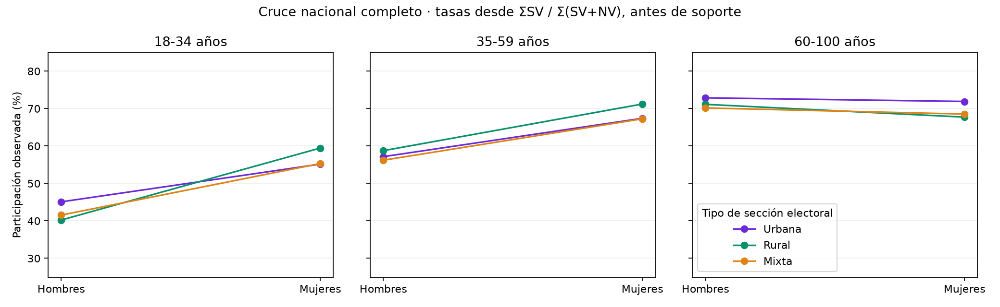
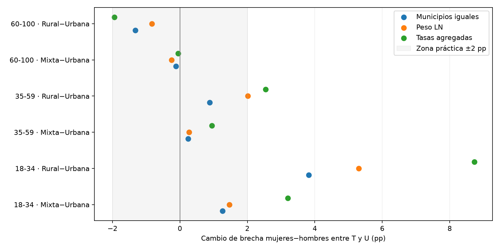
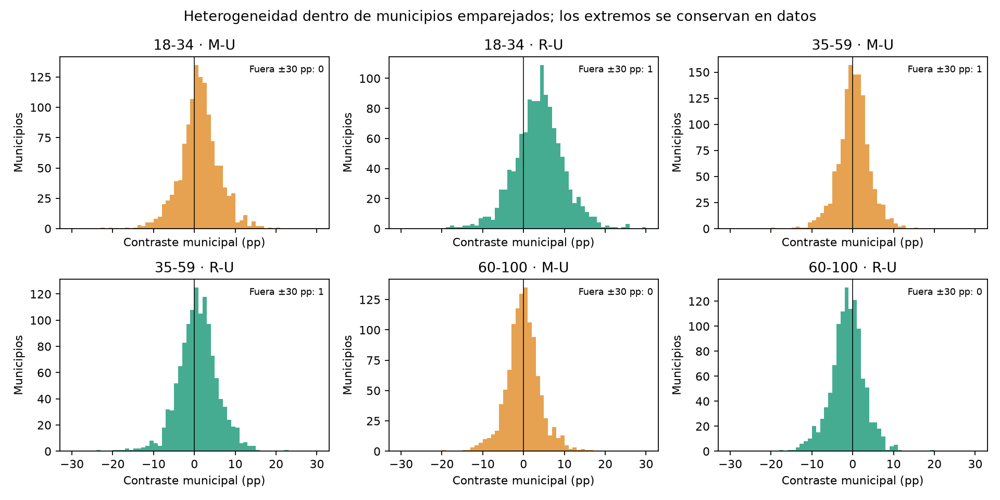

# Edad, sexo, tipo de sección electoral y participación · 2024

Fuentes: `analysis/profile_v2/results/reference/all_observations.parquet`, `data/processed/participamx_multiyear/elections/2024/tables/segments.parquet` y `municipalities.parquet`; [protocolo fijado antes del cálculo](../../reports/protocol.md), [revisión crítica previa](../../reports/v2_critical_review.md). Se preservan 38,805 filas, los 7,335 pendientes y todas las categorías en [referencia](../reference/all_observations.parquet). Las claves se mantienen como texto y no forman distancias.

## Conteos originales y referencias comparables

Las tasas nacionales se forman desde todos los conteos antes de soporte; las siguientes 18 combinaciones no son perfiles aprendidos. La elegibilidad se aplica después y puede cambiar la mezcla territorial. NS se separa de NV, sin imputar; SEXO=2 y 101+ quedan complementarios.

| Edad | Sexo | Tipo de sección | LN | SV+NV | Participación (%) | Municipios elegibles | Fracción LN elegible |
| --- | --- | --- | --- | --- | --- | --- | --- |
| 18-34 | 0 | M | 2471787 | 2310545 | 41.54 | 1935 | 0.99 |
| 18-34 | 0 | R | 3273805 | 3030686 | 40.22 | 1768 | 0.99 |
| 18-34 | 0 | U | 12487448 | 11697331 | 45.08 | 1578 | 1.00 |
| 18-34 | 1 | M | 2571861 | 2404701 | 55.32 | 1936 | 0.99 |
| 18-34 | 1 | R | 3440980 | 3185883 | 59.45 | 1776 | 0.99 |
| 18-34 | 1 | U | 12529062 | 11738927 | 55.16 | 1588 | 1.00 |
| 35-59 | 0 | M | 2677647 | 2505228 | 56.21 | 1994 | 1.00 |
| 35-59 | 0 | R | 3453514 | 3196711 | 58.76 | 1797 | 0.99 |
| 35-59 | 0 | U | 14329984 | 13435253 | 57.15 | 1606 | 1.00 |
| 35-59 | 1 | M | 2938611 | 2751649 | 67.26 | 2003 | 1.00 |
| 35-59 | 1 | R | 3677438 | 3407777 | 71.22 | 1809 | 0.99 |
| 35-59 | 1 | U | 15745063 | 14776795 | 67.40 | 1624 | 1.00 |
| 60-100 | 0 | M | 1024554 | 957756 | 70.17 | 1804 | 0.97 |
| 60-100 | 0 | R | 1654671 | 1534171 | 71.14 | 1659 | 0.99 |
| 60-100 | 0 | U | 5848375 | 5494246 | 72.87 | 1512 | 1.00 |
| 60-100 | 1 | M | 1136409 | 1064666 | 68.54 | 1855 | 0.98 |
| 60-100 | 1 | R | 1712088 | 1591268 | 67.73 | 1680 | 0.99 |
| 60-100 | 1 | U | 7343749 | 6908646 | 71.91 | 1546 | 1.00 |

SEXO 0=Hombres, 1=Mujeres. U/R/M identifica tipo de sección electoral; no residencia individual. La cobertura nominal de la última columna es proporción, no porcentaje. [Conteos y cobertura completos](../interactions/age_sex_section.csv).

## Comparaciones dentro del mismo municipio

Se comparan municipios con las dos o cuatro celdas elegibles necesarias. No se rellenan ausencias con cero. Media municipal es el promedio justificado de contrastes, para dar igual influencia a cada territorio emparejado. Peso LN pondera ese mismo contraste por el nominal de sus componentes. Tasas agregadas primero suma conteos por componente y después contrasta. El último estimando conserva composición de volúmenes distinta entre componentes y puede alejarse del primero: no son tres estimaciones intercambiables de una tasa nacional.

| Contraste | Municipios | Media municipal (pp) | Media con LN (pp) | Desde tasas agregadas (pp) |
| --- | --- | --- | --- | --- |
| sex_18-34_M | 1923 | 15.18 | 13.69 | 13.78 |
| sex_18-34_R | 1757 | 18.00 | 19.20 | 19.26 |
| sex_18-34_U | 1574 | 13.51 | 10.03 | 10.07 |
| sex_35-59_M | 1991 | 10.87 | 10.85 | 11.06 |
| sex_35-59_R | 1786 | 11.47 | 12.31 | 12.48 |
| sex_35-59_U | 1606 | 10.79 | 10.07 | 10.25 |
| sex_60-100_M | 1786 | -1.98 | -1.81 | -1.58 |
| sex_60-100_R | 1647 | -3.26 | -3.62 | -3.41 |
| sex_60-100_U | 1506 | -1.48 | -1.22 | -0.96 |

Las filas `sex_` miden mujeres−hombres de la misma banda/tipo/municipio. Las diferencias por sexo cambian con edad; un agregado de todas las edades mezcla esas curvas. La [estandarización por edad](../interactions/age_standardized_sex_section.csv) usa los mismos pesos nacionales D por banda en todos los cruces sexo/tipo; es ajuste descriptivo, no causal.

| Tipo de sección | Brecha mujeres−hombres agregada (pp) | Brecha mujeres−hombres con edad estandarizada (pp) |
| --- | --- | --- |
| U | 8.67 | 8.05 |
| R | 11.99 | 11.96 |
| M | 10.21 | 9.65 |

Al fijar la misma composición por edad, la brecha agregada por sexo sigue variando entre tipos de sección. Eso no iguala los municipios: por ese motivo se complementa con comparaciones emparejadas, no se interpreta como efecto contextual aislado.

| Contraste | Municipios | Media municipal (pp) | Media con LN (pp) | Desde tasas agregadas (pp) |
| --- | --- | --- | --- | --- |
| section_18-34_0_M_U | 1235 | -1.90 | -5.13 | -2.20 |
| section_18-34_0_R_U | 1231 | -3.50 | -5.94 | -3.18 |
| section_18-34_1_M_U | 1236 | -0.68 | -3.62 | 1.00 |
| section_18-34_1_R_U | 1245 | 0.24 | -0.64 | 5.53 |
| section_35-59_0_M_U | 1263 | -1.00 | -3.69 | -0.52 |
| section_35-59_0_R_U | 1262 | -0.85 | -3.16 | 1.94 |
| section_35-59_1_M_U | 1274 | -0.77 | -3.40 | 0.44 |
| section_35-59_1_R_U | 1274 | -0.05 | -1.13 | 4.49 |
| section_60-100_0_M_U | 1132 | -0.63 | -3.36 | -1.90 |
| section_60-100_0_R_U | 1125 | -0.72 | -3.27 | -0.92 |
| section_60-100_1_M_U | 1155 | -0.79 | -3.71 | -1.98 |
| section_60-100_1_R_U | 1150 | -2.08 | -4.21 | -2.82 |

Las filas `section_` miden R−U o M−U de la misma banda/sexo/municipio; no comparan municipios rurales contra municipios urbanos.

## Seis interacciones predefinidas

I=(Mujeres_T−Hombres_T)−(Mujeres_U−Hombres_U), T=R/M. Cada municipio aporta sus cuatro componentes. I positivo significa una brecha por sexo más amplia en T; no significa que todos sus componentes tengan participación alta. No es un análisis causal de diferencias en diferencias.

| Contraste | Municipios | Media municipal (pp) | Media con LN (pp) | Desde tasas agregadas (pp) | Fracción municipal con mismo signo |
| --- | --- | --- | --- | --- | --- |
| interaction_18-34_M_U | 1227 | 1.26 | 1.47 | 3.20 | 0.63 |
| interaction_18-34_R_U | 1226 | 3.82 | 5.30 | 8.73 | 0.76 |
| interaction_35-59_M_U | 1262 | 0.25 | 0.27 | 0.95 | 0.53 |
| interaction_35-59_R_U | 1255 | 0.88 | 2.01 | 2.54 | 0.58 |
| interaction_60-100_M_U | 1122 | -0.12 | -0.25 | -0.06 | 0.52 |
| interaction_60-100_R_U | 1117 | -1.32 | -0.83 | -1.94 | 0.63 |

La última columna es la fracción municipal con el signo de la media, no un porcentaje de personas. El contraste joven R−U es apreciable dentro de municipios; otras interacciones nacionales se atenúan mucho al igualar territorios. No se da por demostrado un patrón de ≥2 pp sólo porque un gran agregado lo produzca.

## Cambio de las brechas entre edades

Se vuelve a emparejar por municipio entre dos edades, evitando restar medias de territorios diferentes. Estas comparaciones son secundarias descriptivas; no se usan para ampliar retrospectivamente el número de patrones aceptados.

| family | section_contrast | younger | older | Municipios | equal_municipality_difference_pp | nominal_difference_pp | same_sign_fraction |
| --- | --- | --- | --- | --- | --- | --- | --- |
| interaction | R-U | 18-34 | 35-59 | 1219 | 2.89 | 3.27 | 0.73 |
| interaction | R-U | 18-34 | 60-100 | 1104 | 5.31 | 6.12 | 0.80 |
| interaction | R-U | 35-59 | 60-100 | 1114 | 2.26 | 2.80 | 0.68 |
| interaction | M-U | 18-34 | 35-59 | 1224 | 1.04 | 1.21 | 0.61 |
| interaction | M-U | 18-34 | 60-100 | 1111 | 1.38 | 1.82 | 0.62 |
| interaction | M-U | 35-59 | 60-100 | 1121 | 0.38 | 0.53 | 0.56 |
| sex_gap | U | 18-34 | 35-59 | 1570 | 2.66 | -0.11 | 0.72 |
| sex_gap | U | 18-34 | 60-100 | 1490 | 14.85 | 11.19 | 1.00 |
| sex_gap | U | 35-59 | 60-100 | 1504 | 12.31 | 11.28 | 0.99 |
| sex_gap | R | 18-34 | 35-59 | 1746 | 6.45 | 6.57 | 0.89 |
| sex_gap | R | 18-34 | 60-100 | 1622 | 21.42 | 22.61 | 1.00 |
| sex_gap | R | 35-59 | 60-100 | 1643 | 14.82 | 15.89 | 1.00 |
| sex_gap | M | 18-34 | 35-59 | 1921 | 4.22 | 2.70 | 0.82 |
| sex_gap | M | 18-34 | 60-100 | 1764 | 17.14 | 15.44 | 0.99 |
| sex_gap | M | 35-59 | 60-100 | 1786 | 13.00 | 12.59 | 0.99 |

[Valores municipales de todos los contrastes](../interactions/municipal_contrasts.parquet), [distribuciones y soporte](../interactions/contrast_summary.csv), [desglose por entidad](../validation/state_consistency.csv). Las medias pequeñas con estabilidad de signo siguen siendo pequeñas en utilidad práctica; no se publican p-valores de personas.

## Remuestreo y multiplicidad

Mil bootstrap sortean 2,477 municipios con reemplazo; cada clave comparte multiplicidad en todos los contrastes y conserva juntas sus celdas. La banda diagnóstica usa el percentil 95 del máximo absoluto de (estimando_remuestra−estimando_original)/DE_bootstrap, sobre seis interacciones × tres estimandos. Luego se construye estimando_original ± crítico×DE. Se conservan [multiplicidades y resultados](../resampling/municipal_bootstrap.npz), [cobertura](../resampling/bootstrap_coverage.csv) y [bandas simultáneas](../validation/simultaneous_envelopes.csv). No son intervalos de confianza de votantes ni una garantía formal de error familiar: la base reportada no es una muestra probabilística de personas. No se declara significación causal; se combina esta comprobación con magnitud práctica, reparto 60/40 de municipios y sensibilidades. Los municipios sin bloques completos se sortean y cuentan, aunque no aportan contraste.

Referencia técnica primaria: [SciPy bootstrap](https://docs.scipy.org/doc/scipy/reference/generated/scipy.stats.bootstrap.html) describe remuestreo con reemplazo y uso de índices emparejados. La banda máxima conjunta aquí especificada es un diagnóstico propio explícito; no se atribuye a la API de SciPy ni se presenta como BCa. La prueba sintética contrasta el remuestreo emparejado con esa biblioteca.

La banda de NS por extremos utiliza SV/LN y (SV+NS)/LN por componente. Su combinación extrema se guarda en `contrast_summary.csv`: es sensibilidad algebraica, no imputación ni probabilidad. La confirmación dentro de los especificados no asegura que el contraste mantenga signo bajo todas las asignaciones posibles de NS.
