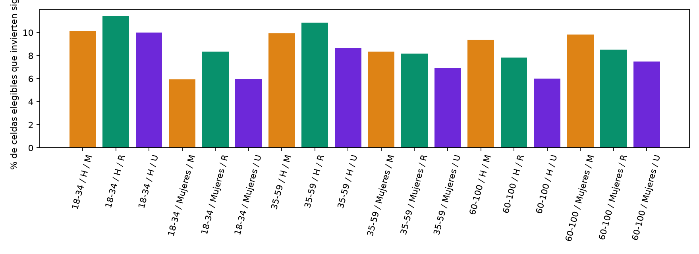

# Investigación de los 2,704 cambios de signo · 2024

Fuentes: `analysis/profile_v2/results/reference/all_observations.parquet`, `data/processed/participamx_multiyear/elections/2024/tables/segments.parquet` y `municipalities.parquet`; [protocolo fijado antes del cálculo](../../reports/protocol.md), [revisión crítica previa](../../reports/v2_critical_review.md). Se preservan 38,805 filas, los 7,335 pendientes y todas las categorías en [referencia](../reference/all_observations.parquet). Las claves se mantienen como texto y no forman distancias.

## Población y denominadores

Se verifican exactamente 2,704/31,470 celdas elegibles (8.59 %), LN=5,688,327/97,999,677 (5.80 %) y D=5,348,335/91,817,589 (5.82 % del especificado). Hay 1,099 municipios con al menos un cambio: 45.94 % de los 2,392 elegibles y 44.37 % de los 2,477 originales. Ni filas ni municipios equivalen a personas; los conjuntos territoriales se superponen entre cruces.

Cada hijo y padre usa la misma referencia nacional banda/sexo de todos los conteos originales. El signo se calcula por productos cruzados enteros, no por porcentajes redondeados; un denominador nulo no recibe signo. No se llama cambio al efecto de sustituir esa referencia por otra U/R/M.

## Distribución conjunta

| Edad | Sexo | Tipo de sección | Celdas elegibles | Cambios de signo | Fracción de celdas con cambio | Municipios con cambios | LN de cambios | SV+NV de cambios |
| --- | --- | --- | --- | --- | --- | --- | --- | --- |
| 18-34 | 0 | M | 1935 | 196 | 0.10 | 196 | 338107 | 315336 |
| 18-34 | 0 | R | 1768 | 202 | 0.11 | 202 | 372096 | 346218 |
| 18-34 | 0 | U | 1578 | 158 | 0.10 | 158 | 798618 | 762459 |
| 18-34 | 1 | M | 1936 | 115 | 0.06 | 115 | 175144 | 159403 |
| 18-34 | 1 | R | 1776 | 148 | 0.08 | 148 | 252994 | 236424 |
| 18-34 | 1 | U | 1588 | 95 | 0.06 | 95 | 264923 | 249557 |
| 35-59 | 0 | M | 1994 | 198 | 0.10 | 198 | 340007 | 315476 |
| 35-59 | 0 | R | 1797 | 195 | 0.11 | 195 | 310105 | 290323 |
| 35-59 | 0 | U | 1606 | 139 | 0.09 | 139 | 636683 | 598639 |
| 35-59 | 1 | M | 2003 | 167 | 0.08 | 167 | 247973 | 228827 |
| 35-59 | 1 | R | 1809 | 148 | 0.08 | 148 | 262246 | 244949 |
| 35-59 | 1 | U | 1624 | 112 | 0.07 | 112 | 862651 | 826183 |
| 60-100 | 0 | M | 1804 | 169 | 0.09 | 169 | 113064 | 104760 |
| 60-100 | 0 | R | 1659 | 130 | 0.08 | 130 | 118177 | 109061 |
| 60-100 | 0 | U | 1512 | 91 | 0.06 | 91 | 141415 | 132366 |
| 60-100 | 1 | M | 1855 | 182 | 0.10 | 182 | 132732 | 125018 |
| 60-100 | 1 | R | 1680 | 143 | 0.09 | 143 | 127033 | 119654 |
| 60-100 | 1 | U | 1546 | 116 | 0.08 | 116 | 194359 | 183682 |

Las fracciones se refieren a cada cruce elegible, no al total de 2,704. U/R/M por volumen y por número de filas puede dar órdenes distintos. También se guardan resúmenes [por edad](../sign_reversals/by_age.csv), [sexo](../sign_reversals/by_sex.csv), [tipo](../sign_reversals/by_section.csv), [V1](../sign_reversals/by_v1_profile.csv) y [municipio](../sign_reversals/by_municipality.csv).

## Territorios y concentración

| EDOCVE | state_name_label | Cambios de signo | Fracción de celdas con cambio | Municipios con cambios | LN de cambios |
| --- | --- | --- | --- | --- | --- |
| 11 | GUANAJUATO | 99 | 0.13 | 34 | 792315 |
| 15 | MEXICO | 133 | 0.07 | 45 | 616391 |
| 30 | VERACRUZ | 412 | 0.13 | 168 | 522390 |
| 14 | JALISCO | 184 | 0.09 | 77 | 506157 |
| 22 | QUERETARO | 57 | 0.20 | 15 | 392167 |
| 16 | MICHOACAN | 188 | 0.11 | 71 | 308803 |
| 7 | CHIAPAS | 100 | 0.06 | 46 | 272354 |
| 21 | PUEBLA | 190 | 0.07 | 84 | 240102 |
| 1 | AGUASCALIENTES | 28 | 0.15 | 10 | 205091 |
| 13 | HIDALGO | 114 | 0.09 | 39 | 201599 |

Orden por LN de los cambios; no por su frecuencia estatal ni causalidad. Los diez municipios con mayor LN de cambios concentran 26.21 % de ese volumen. La tabla municipal conserva todas las claves elegibles, incluidas las que no presentan inversión.

## Intensidad y soporte

Mediana de |Δ hijo|=1.87 pp; |Δ padre|=1.65 pp. 1,413 hijos y 1,555 padres están a ≤2 pp; esas cuentas se superponen. Sólo 562 cambios tienen ambos extremos a >2 pp y 101 a >5 pp. El D mediano del hijo que invierte es 686, frente a 686 en los demás elegibles. Los denominadores importan, pero esa comparación no demuestra que los cambios sean exclusivamente ruido.

| Escenario | Celdas elegibles | Municipios elegibles | eligible_LN | Cambios de signo | Fracción de celdas con cambio | original_reversals_surviving | surviving_fraction_of_2704 |
| --- | --- | --- | --- | --- | --- | --- | --- |
| support_50_sources_5 | 33440 | 2453 | 98183333 | 2908 | 0.09 | 2704 | 1.00 |
| support_100_sources_5 | 31470 | 2392 | 97999677 | 2704 | 0.09 | 2704 | 1.00 |
| support_200_sources_5 | 27187 | 2252 | 97279052 | 2296 | 0.08 | 2296 | 0.85 |
| support_500_sources_5 | 18794 | 1845 | 94245302 | 1612 | 0.09 | 1612 | 0.60 |
| support_100_sources_1 | 31470 | 2392 | 97999677 | 2704 | 0.09 | 2704 | 1.00 |
| low_ns | 25254 | 2258 | 81099867 | 2129 | 0.08 | 2129 | 0.79 |
| five_sections | 13572 | 1420 | 88330656 | 1146 | 0.08 | 1146 | 0.42 |

La supervivencia mantiene como base los 2,704 iniciales; la frecuencia de inversión usa la población de cada escenario. No confundir ambas. A soporte 50 se pueden incorporar nuevos hijos, pero sólo se consideran inversiones respecto de padres con ficha V1 original; no se reconstruye una V1 distinta para mejorar cobertura. NS<10 % y cinco secciones son sensibilidades, no cambios de las fuentes.

1,783 cambios mantendrían el signo del hijo bajo los extremos de NS local frente a referencia observada fija; 630 bajo los extremos locales y nacionales. Esto no valida automáticamente su diferencia sustantiva: puede ser pequeña y tener NS=0. Son límites algebraicos, no probabilidades.

## Qué significa la inversión

El delta del padre es ΣD_hijo×delta_hijo/ΣD_hijo. Residuo máximo de esa identidad: 1.11e-16. El hijo inversor tiene una mediana de 25.97 % del D del padre. En todos los cambios verificados, el resto de tipos del mismo padre sostiene el signo del agregado. Es heterogeneidad entre partes de una media ponderada, compatible con concentración y composición; no demuestra por sí sola una inversión de asociación entre dos variables al condicionar una tercera, por lo que no se etiqueta como paradoja de Simpson.

La señal es útil para revisar subsegmentos y evitar nombres homogéneos. Su frecuencia por cruce no basta para convertirla en cuatro a seis clases. [Traza completa](../sign_reversals/all_2704.parquet), [descomposición padre/resto](../sign_reversals/decomposition.parquet), [cruce de magnitudes](../sign_reversals/magnitude_cross.csv) y [resumen reproducible](../sign_reversals/summary.json).
