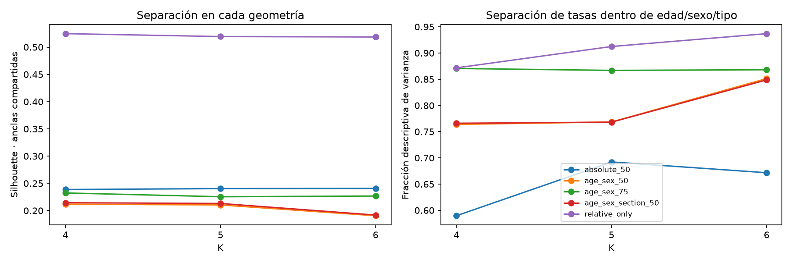
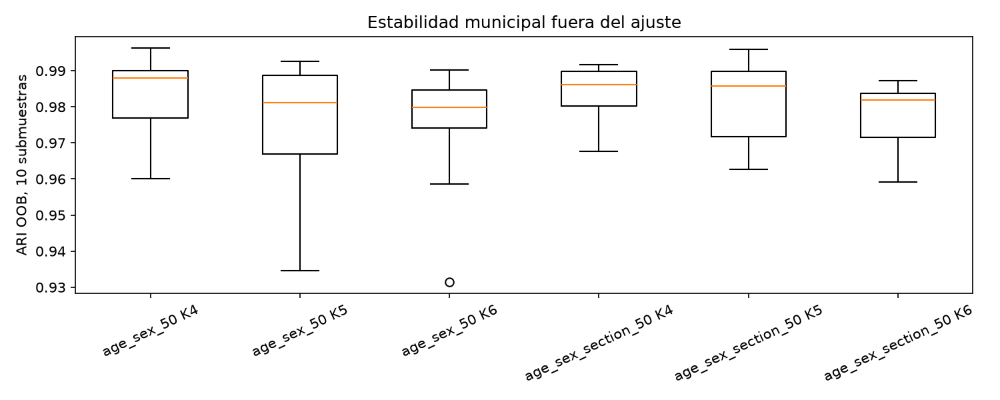
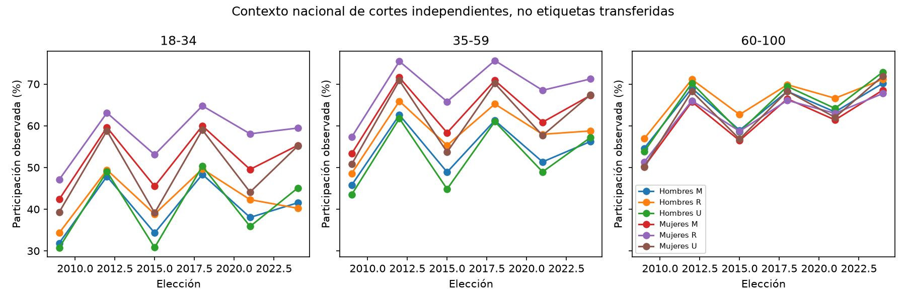

# Segmentación multivariable experimental de perfiles · 2024

**Los datos permiten construir particiones reproducibles de cuatro, cinco y seis grupos, pero esta prueba no respalda sustituir las seis fichas actuales por una tipología conjunta estable de edad, sexo y tipo de sección.** La principal ampliación verificable es observar tasas e intensidad dentro del cruce real, antes ocultas por la agregación. Las categorías añadidas cambian la distancia; no se convierten por ello en clases naturales o rasgos individuales.

**Recomendación:** conservar V1 como clasificación descriptiva comunicable y enriquecer su evidencia con el cruce U/R/M, denominadores y referencias alternativas. Si se continúa investigando una partición, mantener `age_sex_50`, K=4, como candidato parsimonioso de revisión y `age_sex_section_50`, K=4, como control contextual, **sin adoptarlos ni presentarlos como cuatro perfiles definitivos**. K=5/6 permanecen documentados: el número solicitado por el reto no determina la existencia de grupos naturales. La recomendación no selecciona un ganador por Silhouette.

En las tablas, tasas, coberturas, purezas y R² son proporciones en [0,1], salvo columnas explícitas en puntos porcentuales. Una proporción de 0.99 corresponde a 99 %, no 0.99 %. Los conteos de segmentos, municipios y LN son unidades distintas.

## Recuperación y comparación de las seis fichas actuales

Unidad V1: municipio × banda × sexo. Reglas: tres bandas H/M 18–100 × signo exacto frente a la referencia nacional propia de banda/sexo. Soporte LN≥100, SV+NV≥100 y filas fuente≥5; NS advierte y no se imputa. Son reglas transparentes con 14,190 segmentos, 2,402 municipios y LN=98,203,780. Edad/signo definen su diferenciación, con 13.20 % de segmentos a ≤2 pp de la referencia; ni esa frontera ni su nombre identifican motivación o seis clases naturales.

| profile_id | segments | municipalities | states | LN | SV | NV | NS | participation_observed | matched_peer_reference | participation_delta | near_reference_fraction | high_ns_fraction |
| --- | --- | --- | --- | --- | --- | --- | --- | --- | --- | --- | --- | --- |
| adult_favorable | 3015 | 1641 | 31 | 20337701 | 13282203 | 5876703 | 1178795 | 0.6933 | 0.6282 | 0.0651 | 0.1058 | 0.2126 |
| adult_unfavorable | 1767 | 1018 | 31 | 22444975 | 11914868 | 8989939 | 1540168 | 0.5700 | 0.6296 | -0.0596 | 0.1822 | 0.1669 |
| older_favorable | 2606 | 1445 | 30 | 10367836 | 7581710 | 2231358 | 554768 | 0.7726 | 0.7148 | 0.0578 | 0.1324 | 0.2015 |
| older_unfavorable | 2078 | 1189 | 30 | 8319793 | 4949523 | 2772367 | 597903 | 0.6410 | 0.7144 | -0.0734 | 0.1554 | 0.1891 |
| young_favorable | 2688 | 1522 | 31 | 17237993 | 9276190 | 6888087 | 1073716 | 0.5739 | 0.4969 | 0.0769 | 0.0941 | 0.2254 |
| young_unfavorable | 2036 | 1200 | 31 | 19495482 | 7870373 | 10321265 | 1303844 | 0.4326 | 0.5010 | -0.0683 | 0.1528 | 0.1582 |

Sus fortalezas son claridad, referencias verificables y cobertura. Sus límites son frontera convencional, bandas amplias, soporte territorial desigual y contexto no incorporado a la asignación. Los antecedentes multidimensionales y de arquetipos ya mostraban gradientes, dependencia de representación y colas de inestabilidad; este trabajo no los ignora ni reinterpreta como una validación previa de V2. La revisión de documentos fuente queda en metadata/source_review.json. No se modifican fichas, JSON publicados o estrategias.

## Disponibilidad y unidad V2

Se recuperó el cruce real de las seis elecciones desde Parquet validados. No se leyeron CSV originales ni se multiplicaron marginales del Atlas. V2 = municipio × banda × sexo × tipo de sección × elección; los 38,805 registros de 2024 representan 9,773,730 celdas fuente, no personas ni 38,805 secciones independientes.

| year | cells | eligible | municipalities | eligible_municipalities | LN | eligible_LN | nominal_fraction | undefined | high_ns | sex_2_available | sex_2_cells |
| --- | --- | --- | --- | --- | --- | --- | --- | --- | --- | --- | --- |
| 2009 | 40743 | 30619 | 2458 | 2387 | 77481831 | 77125896 | 0.9954 | 235 | 2168 | False | n/d |
| 2012 | 37691 | 30418 | 2455 | 2384 | 76490962 | 76246080 | 0.9968 | 42 | 355 | False | n/d |
| 2015 | 38324 | 30337 | 2458 | 2354 | 83563462 | 83149610 | 0.9950 | 705 | 5945 | False | n/d |
| 2018 | 38155 | 30689 | 2463 | 2379 | 89123997 | 88722387 | 0.9955 | 553 | 7548 | False | n/d |
| 2021 | 38835 | 31247 | 2468 | 2387 | 93532133 | 93124001 | 0.9956 | 426 | 4972 | False | n/d |
| 2024 | 38805 | 31470 | 2477 | 2392 | 98330348 | 97999677 | 0.9966 | 493 | 7436 | True | 67.0000 |

Principal común: **31,470 segmentos, 2,392/2,477 municipios, LN=97,999,677, 99.6637% del anual** (97,999,677 / 98,330,348). Los 7,335 pendientes siguen en referencia, con etiquetas NULL. La pérdida frente a V1 es 10 municipios y LN=204,103, pese al mayor número de filas. Hay soporte suficiente para un piloto acotado, no para afirmar cobertura territorial completa o fiabilidad universal. El [informe de auditoría](variable_audit.md) desglosa estados, denominadores, ausencias, umbrales, NS y no binarios.

| pending_reason | segments | eligible_segments | LN | eligible_LN | nominal_fraction | municipalities | eligible_municipalities | undefined | high_ns | few_sections |
| --- | --- | --- | --- | --- | --- | --- | --- | --- | --- | --- |
| complementary | 4281 | 0 | 13302 | 0 | 0.0000 | 1752 | 0 | 163 | 503 | 3861 |
| eligible | 31470 | 31470 | 97999677 | 97999677 | 1.0000 | 2392 | 2392 | 0 | 6216 | 17898 |
| insufficient_support | 2724 | 0 | 214372 | 0 | 0.0000 | 686 | 0 | 0 | 387 | 2712 |
| undefined_rate | 330 | 0 | 102997 | 0 | 0.0000 | 45 | 0 | 330 | 330 | 312 |

SEXO=2 conserva LN=105 y sus 105 filas fuente; su soporte no permite la comparación H/M de este experimento. 101+ permanece en los totales y complementos. No se imputa ni se transforma NS en NV. Las tres bandas actuales mantienen la comparación con V1; cinco bandas pierden más soporte (2,337 municipios y 99.1376% LN), por lo que no se amplía la búsqueda de modelos a ese escenario. No se fijan bandas definitivas.

## Método, normalización y controles

Se utiliza K-Means de scikit-learn con representación de datos mixtos documentada: una coordenada electoral estandarizada más one-hot simétricos de banda, sexo y tipo. En el principal, 50 % de la varianza de entrada corresponde a participación y 50 % al conjunto de categorías; cada categoría aporta un tercio de ese segundo bloque. Las escalas se ajustan sólo a los elegibles. No se usan edad media, códigos ordinales, municipio/distancia geográfica, conteos absolutos o NS como coordenadas. La normalización por bloque impide que el simple número de dummies imponga su peso; **no elimina la dependencia respecto del peso elegido**.

Las cinco configuraciones son absoluta; diferencia frente a banda/sexo; diferencia frente a banda/sexo/tipo; esa diferencia con 75 % electoral; y un control relativo de una dimensión. No se introducen tasa y diferencia simultáneamente. El referente nacional se calcula con todos los conteos antes de soporte. Incorporar tipo a la referencia cambia los umbrales hasta 3.52 pp en el núcleo; puede retirar precisamente parte de las diferencias contextuales que se quieren describir.

Se completaron **123 ajustes**: 45 principales (5 configuraciones × 3 K × 3 semillas), 18 sensibilidades y 60 de remuestreo. Tres semillas 17/42/2024, 20 inicios principales, Lloyd, tol=10⁻⁶, máximo 1,000 iteraciones, un hilo; todos se detuvieron antes del límite. Las 15 soluciones representativas son las de menor SSE dentro de cada configuración/K, no un K ganador. K-prototypes no está disponible (`kmodes` no instalado); no se instala ni inventa un optimizador mixto propio. La [metodología completa](../../reports/methodology.md) detalla geometría, presupuestos y límites. [KMeans, documentación primaria](https://scikit-learn.org/stable/modules/generated/sklearn.cluster.KMeans.html).

## Comparación de cuatro, cinco y seis grupos

Silhouette: 384 anclas uniformes compartidas contra todos los segmentos, por bloques; no matriz N×N. DB usa la población completa. Se guardan SSE, tamaños y métricas de todas las semillas. El R² condicional compara varianza de tasas dentro de edad/sexo/tipo antes/después de añadir etiquetas; mide separación descriptiva, no exactitud o información externa. Las métricas internas pertenecen a sus propias geometrías y no prueban superioridad universal. [Silhouette, referencia primaria](https://scikit-learn.org/stable/modules/generated/sklearn.metrics.silhouette_score.html).

| config | K | sizes | silhouette | DB | seed_ARI_min | OOB_median | OOB_min | conditional_joint_R2 | sex_purity | section_purity |
| --- | --- | --- | --- | --- | --- | --- | --- | --- | --- | --- |
| absolute_50 | 4 | [8905, 7007, 7387, 8171] | 0.2387 | 1.4380 | 1.0000 | n/d | n/d | 0.5897 | 0.9794 | 0.3663 |
| absolute_50 | 5 | [5426, 6364, 7023, 4542, 8115] | 0.2404 | 1.4098 | 0.9994 | n/d | n/d | 0.6922 | 0.9784 | 0.3663 |
| absolute_50 | 6 | [5522, 6383, 5864, 3931, 4340, 5430] | 0.2408 | 1.4736 | 0.9984 | n/d | n/d | 0.6717 | 0.9841 | 0.3668 |
| age_sex_50 | 4 | [5967, 9982, 6257, 9264] | 0.2118 | 1.4678 | 1.0000 | 0.9880 | 0.9601 | 0.7639 | 0.8376 | 0.3663 |
| age_sex_50 | 5 | [5453, 8520, 8274, 4748, 4475] | 0.2104 | 1.5665 | 1.0000 | 0.9811 | 0.9345 | 0.7685 | 0.9466 | 0.3663 |
| age_sex_50 | 6 | [6845, 6363, 6281, 6487, 2867, 2627] | 0.1906 | 1.5283 | 0.9869 | 0.9799 | 0.9315 | 0.8513 | 0.9197 | 0.3663 |
| age_sex_section_50 | 4 | [10032, 9263, 5935, 6240] | 0.2145 | 1.4739 | 0.9957 | 0.9861 | 0.9676 | 0.7660 | 0.8214 | 0.3739 |
| age_sex_section_50 | 5 | [5573, 8353, 8318, 5066, 4160] | 0.2131 | 1.5670 | 0.9995 | 0.9858 | 0.9627 | 0.7682 | 0.9440 | 0.3771 |
| age_sex_section_50 | 6 | [6890, 6543, 6435, 6302, 2677, 2623] | 0.1919 | 1.5127 | 0.9954 | 0.9820 | 0.9592 | 0.8487 | 0.9279 | 0.3751 |
| age_sex_75 | 4 | [11151, 4459, 11267, 4593] | 0.2324 | 1.2984 | 1.0000 | n/d | n/d | 0.8706 | 0.5197 | 0.3663 |
| age_sex_75 | 5 | [9918, 6750, 6572, 3966, 4264] | 0.2255 | 1.3819 | 1.0000 | n/d | n/d | 0.8669 | 0.7244 | 0.3663 |
| age_sex_75 | 6 | [3708, 5903, 3875, 6135, 5912, 5937] | 0.2268 | 1.4661 | 0.9988 | n/d | n/d | 0.8681 | 0.8862 | 0.3663 |
| relative_only | 4 | [11190, 4379, 11246, 4655] | 0.5247 | 0.5616 | 0.9964 | n/d | n/d | 0.8717 | 0.5166 | 0.3663 |
| relative_only | 5 | [9754, 8660, 7186, 2579, 3291] | 0.5194 | 0.5517 | 0.9970 | n/d | n/d | 0.9124 | 0.5244 | 0.3663 |
| relative_only | 6 | [5492, 1943, 1807, 8291, 8292, 5645] | 0.5186 | 0.5451 | 0.9651 | n/d | n/d | 0.9370 | 0.5244 | 0.3663 |

La tabla estructurada `comparisons/candidate_summary.csv` añade cobertura, método, ventajas, límites e interpretabilidad de cada una de las 15 alternativas. No se comparan municipios como observaciones disjuntas entre clusters: un mismo municipio aporta varias celdas y puede aparecer en varios grupos. Las fichas completas están en [candidates](candidates/), con 75 caracterizaciones (incluidos controles), conteos, distribuciones por filas/LN, tasas, referencias mezcladas, heterogeneidad, NS, soporte y entidades.

## Qué aporta realmente cada dimensión

En las dos representaciones relativas de 50 %, la pureza por sexo va de 82.14% a 94.66%. La pureza U/R/M permanece cerca de su distribución global por segmentos: el contexto no genera aquí una separación fuerte entre tipos. Que las categorías estén en la matriz no demuestra que cuatro a seis perfiles combinen de manera sustantiva todas ellas. La representación absoluta alcanza purezas por sexo cercanas al 98 %; eso responde también al diseño de la distancia y a las tasas absolutas diferentes.

| config | K | participation_separation_share | age_share | sex_share | section_share |
| --- | --- | --- | --- | --- | --- |
| absolute_50 | 4 | 0.6661 | 0.0456 | 0.2881 | 0.0002 |
| absolute_50 | 5 | 0.6752 | 0.0653 | 0.2591 | 0.0004 |
| absolute_50 | 6 | 0.6346 | 0.1129 | 0.2521 | 0.0005 |
| age_sex_50 | 4 | 0.7772 | 0.0100 | 0.2111 | 0.0016 |
| age_sex_50 | 5 | 0.7197 | 0.0093 | 0.2695 | 0.0014 |
| age_sex_50 | 6 | 0.7485 | 0.0086 | 0.2417 | 0.0013 |
| age_sex_section_50 | 4 | 0.7814 | 0.0065 | 0.2098 | 0.0023 |
| age_sex_section_50 | 5 | 0.7192 | 0.0072 | 0.2717 | 0.0019 |
| age_sex_section_50 | 6 | 0.7466 | 0.0067 | 0.2449 | 0.0018 |
| age_sex_75 | 4 | 0.9962 | 0.0029 | 0.0005 | 0.0004 |
| age_sex_75 | 5 | 0.9452 | 0.0028 | 0.0516 | 0.0004 |
| age_sex_75 | 6 | 0.9085 | 0.0028 | 0.0884 | 0.0004 |
| relative_only | 4 | 1.0000 | 0.0000 | 0.0000 | 0.0000 |
| relative_only | 5 | 1.0000 | 0.0000 | 0.0000 | 0.0000 |
| relative_only | 6 | 1.0000 | 0.0000 | 0.0000 | 0.0000 |

Estas proporciones corresponden a suma de cuadrados entre centroides en cada bloque; no son importancia causal ni variables independientes. Al subir a 75 % la participación, K4 se aproxima al control relativo puro: la separación de categorías puede casi desaparecer. La sensibilidad muestra que un reparto matemático explícito sigue siendo una decisión sustantiva. No se recomienda subir el peso de U/R/M sólo para obtener nombres más diversos.

| k | left | right | ARI |
| --- | --- | --- | --- |
| 4 | age_sex_50 | absolute_50 | 0.3181 |
| 4 | age_sex_50 | age_sex_section_50 | 0.8093 |
| 4 | age_sex_50 | age_sex_75 | 0.3116 |
| 4 | age_sex_50 | relative_only | 0.3106 |
| 5 | age_sex_50 | absolute_50 | 0.3540 |
| 5 | age_sex_50 | age_sex_section_50 | 0.8146 |
| 5 | age_sex_50 | age_sex_75 | 0.5164 |
| 5 | age_sex_50 | relative_only | 0.3440 |
| 6 | age_sex_50 | absolute_50 | 0.2776 |
| 6 | age_sex_50 | age_sex_section_50 | 0.7820 |
| 6 | age_sex_50 | age_sex_75 | 0.8306 |
| 6 | age_sex_50 | relative_only | 0.3571 |
| 4 | age_sex_75 | relative_only | 0.9679 |
| 5 | age_sex_75 | relative_only | 0.3570 |
| 6 | age_sex_75 | relative_only | 0.3767 |

La referencia conjunta cambia asignaciones (ARI entre las dos representaciones relativas en torno a 0.78–0.81), sin convertir U/R/M en una nueva tipología claramente separada. La decisión de descontar tipo debe responder a la pregunta de comparación; no se elige la referencia por el mejor índice interno.

Un aporte verificable del cruce, independiente de elegir K, es que **2,704 hijos elegibles (8.59% de segmentos, 5.80% del LN entrenado)** cambian de signo frente a la referencia edad/sexo respecto al agregado V1 de su mismo municipio/banda/sexo. Esto identifica heterogeneidad oculta por agregar tipos; no prueba que los clusters la describan mejor ni convierte esos hijos en personas distintas.

En el candidato `age_sex_50`, K4, las etiquetas locales C1 y C3 son íntegramente Hombres y Mujeres, respectivamente, con diferencias agregadas de aproximadamente +1.81 y +1.29 pp frente a sus pares. C0 y C2 describen contrastes relativos más amplios (+17.66 y −12.80 pp). No son cuatro combinaciones equilibradas de edad/sexo/U/R/M: dos etiquetas centrales se distinguen principalmente por una categoría ya introducida en la distancia. Es un motivo concreto para mantenerlo como diagnóstico y no promoverlo a perfiles definitivos.

## Estabilidad, cobertura y sensibilidad de calidad

| config | k | OOB_median | OOB_min | OOB_max | below_090 |
| --- | --- | --- | --- | --- | --- |
| age_sex_50 | 4 | 0.9880 | 0.9601 | 0.9963 | 0 |
| age_sex_50 | 5 | 0.9811 | 0.9345 | 0.9926 | 0 |
| age_sex_50 | 6 | 0.9799 | 0.9315 | 0.9902 | 0 |
| age_sex_section_50 | 4 | 0.9861 | 0.9676 | 0.9916 | 0 |
| age_sex_section_50 | 5 | 0.9858 | 0.9627 | 0.9960 | 0 |
| age_sex_section_50 | 6 | 0.9820 | 0.9592 | 0.9873 | 0 |

Diez submuestras sin reemplazo de 1,981/2,477 municipios mantienen juntos todos sus segmentos. Se recalibran escalas sólo in-bag y se evalúa ARI sobre municipios OOB frente al ajuste principal de la misma configuración/K. Las referencias nacionales siguen fijas e incluyen OOB: **estabilidad condicional, no predicción independiente del proceso nacional**. ARI no requiere alinear números de etiquetas. [Definición primaria de ARI](https://scikit-learn.org/stable/modules/generated/sklearn.metrics.adjusted_rand_score.html).

| sample | drawn_municipalities | active_municipalities | training_segments | training_LN | fraction_of_eligible_LN | fraction_of_annual_LN | original_segments | original_LN | oob_segments | oob_municipalities |
| --- | --- | --- | --- | --- | --- | --- | --- | --- | --- | --- |
| 0 | 1981 | 1911 | 25106 | 74823649 | 0.7635 | 0.7609 | 31028 | 75075623 | 6364 | 481 |
| 1 | 1981 | 1916 | 25157 | 79740317 | 0.8137 | 0.8109 | 30992 | 79981750 | 6313 | 476 |
| 2 | 1981 | 1911 | 25092 | 80208241 | 0.8185 | 0.8157 | 30964 | 80467031 | 6378 | 481 |
| 3 | 1981 | 1914 | 25231 | 79091020 | 0.8071 | 0.8043 | 31080 | 79363857 | 6239 | 478 |
| 4 | 1981 | 1908 | 24839 | 77352731 | 0.7893 | 0.7867 | 30737 | 77639559 | 6631 | 484 |
| 5 | 1981 | 1909 | 25248 | 82068517 | 0.8374 | 0.8346 | 31112 | 82343933 | 6222 | 483 |
| 6 | 1981 | 1919 | 25189 | 80265455 | 0.8190 | 0.8163 | 31072 | 80528063 | 6281 | 473 |
| 7 | 1981 | 1914 | 25249 | 76406853 | 0.7797 | 0.7770 | 31195 | 76689137 | 6221 | 478 |
| 8 | 1981 | 1915 | 25214 | 81270120 | 0.8293 | 0.8265 | 31148 | 81550633 | 6256 | 477 |
| 9 | 1981 | 1918 | 25017 | 74166939 | 0.7568 | 0.7543 | 30894 | 74435457 | 6453 | 474 |

Las medianas y mínimos OOB son altos dentro de una geometría fija, pero no solucionan su dependencia de pesos ni demuestran clases naturales. Diez muestras son exploratorias; no son intervalos de confianza ni incertidumbre de personas.

| config | scope | k | n | municipalities | nominal_fraction | ARI_common | ARI_all_main |
| --- | --- | --- | --- | --- | --- | --- | --- |
| age_sex_50 | equal_municipality | 4 | 31470 | 2392 | 0.9966 | 0.9547 | 0.9547 |
| age_sex_50 | equal_municipality | 5 | 31470 | 2392 | 0.9966 | 0.4108 | 0.4108 |
| age_sex_50 | equal_municipality | 6 | 31470 | 2392 | 0.9966 | 0.9482 | 0.9482 |
| age_sex_50 | low_ns | 4 | 25254 | 2258 | 0.8248 | 0.9909 | 0.9909 |
| age_sex_50 | low_ns | 5 | 25254 | 2258 | 0.8248 | 0.9868 | 0.9868 |
| age_sex_50 | low_ns | 6 | 25254 | 2258 | 0.8248 | 0.9660 | 0.9662 |
| age_sex_50 | five_sections | 4 | 13572 | 1420 | 0.8983 | 0.4058 | 0.3849 |
| age_sex_50 | five_sections | 5 | 13572 | 1420 | 0.8983 | 0.8187 | 0.8006 |
| age_sex_50 | five_sections | 6 | 13572 | 1420 | 0.8983 | 0.3974 | 0.4183 |
| age_sex_section_50 | equal_municipality | 4 | 31470 | 2392 | 0.9966 | 0.9545 | 0.9545 |
| age_sex_section_50 | equal_municipality | 5 | 31470 | 2392 | 0.9966 | 0.3990 | 0.3990 |
| age_sex_section_50 | equal_municipality | 6 | 31470 | 2392 | 0.9966 | 0.9385 | 0.9385 |
| age_sex_section_50 | low_ns | 4 | 25254 | 2258 | 0.8248 | 0.9903 | 0.9904 |
| age_sex_section_50 | low_ns | 5 | 25254 | 2258 | 0.8248 | 0.9877 | 0.9879 |
| age_sex_section_50 | low_ns | 6 | 25254 | 2258 | 0.8248 | 0.9854 | 0.9850 |
| age_sex_section_50 | five_sections | 4 | 13572 | 1420 | 0.8983 | 0.4196 | 0.3869 |
| age_sex_section_50 | five_sections | 5 | 13572 | 1420 | 0.8983 | 0.6527 | 0.5875 |
| age_sex_section_50 | five_sections | 6 | 13572 | 1420 | 0.8983 | 0.3945 | 0.3928 |

**K5 es especialmente sensible al peso municipal:** ARI=0.399–0.411 al cambiar el objetivo de peso segmento a peso total municipal uno. No se deduce ese resultado de las semillas estables: son perturbaciones distintas. Exigir cinco secciones por celda deja 13,572 segmentos y 89.83 % del LN anual; sus cambios de asignación son importantes, aunque mezclan selección territorial, distribución y optimización. NS bajo deja 25,254 segmentos y 82.48 % del LN anual, con concordancia mucho mayor. Esto no demuestra ausencia de sesgo de NS ni el comportamiento que tendrían los registros no especificados.

| weighting | used_in_models | top10_municipal_share | equivalent_municipal_concentration | mean_turnout | mean_relative_pp |
| --- | --- | --- | --- | --- | --- |
| equal_segment | True | 0.0057 | 2123.4153 | 0.6344 | 2.2493 |
| equal_municipality | True | 0.0042 | 2392.0000 | 0.6366 | 2.4645 |
| LN_descriptive_only | False | 0.1305 | 251.8452 | 0.5959 | -0.0682 |

La ponderación LN se documenta sin ajustar modelos con ella. La concentración equivalente describe reparto municipal de masa; no es tamaño muestral efectivo ni número de personas. Los criterios de soporte no garantizan independencia: 56.87% de los segmentos elegibles procede de menos de cinco secciones distintas.

## Caracterización y comparación honesta con V1

Cada ficha candidata tiene ID experimental, año, unidad y método, dos párrafos descriptivos, composición por edad/sexo/tipo tanto por filas como por LN, registros SV/NV/NS, referencias mezcladas por D, diferencia, dispersión, bases mínimas/medianas, municipios, entidades y concentración. Los nombres provisionales identifican combinaciones modales del ajuste; **no diagnostican personalidad, preferencias, necesidad de atención o eficacia de estrategias**. Las variables usadas para construir la partición no se presentan como validación externa de sus diferencias.

V1 y V2 tienen unidades distintas. Para el contraste numérico se hereda la etiqueta V1 del padre a cada hijo, sin expandir hijos ni tratarlos como perfiles V1 independientes. El R² y ARI siguientes se calculan sólo sobre las mismas celdas V2; no son un ARI directo entre las 14,190 filas previas y 31,470 actuales.

| config | k | conditional_joint_r2 | v1_parent_conditional_joint_r2 | ARI_inherited_parent |
| --- | --- | --- | --- | --- |
| absolute_50 | 4 | 0.5897 | 0.5554 | 0.1635 |
| absolute_50 | 5 | 0.6922 | 0.5554 | 0.1855 |
| absolute_50 | 6 | 0.6717 | 0.5554 | 0.2387 |
| age_sex_50 | 4 | 0.7639 | 0.5554 | 0.0985 |
| age_sex_50 | 5 | 0.7685 | 0.5554 | 0.1310 |
| age_sex_50 | 6 | 0.8513 | 0.5554 | 0.1377 |
| age_sex_section_50 | 4 | 0.7660 | 0.5554 | 0.0903 |
| age_sex_section_50 | 5 | 0.7682 | 0.5554 | 0.1312 |
| age_sex_section_50 | 6 | 0.8487 | 0.5554 | 0.1294 |
| age_sex_75 | 4 | 0.8706 | 0.5554 | 0.1616 |
| age_sex_75 | 5 | 0.8669 | 0.5554 | 0.1544 |
| age_sex_75 | 6 | 0.8681 | 0.5554 | 0.1319 |
| relative_only | 4 | 0.8717 | 0.5554 | 0.1584 |
| relative_only | 5 | 0.9124 | 0.5554 | 0.1387 |
| relative_only | 6 | 0.9370 | 0.5554 | 0.1394 |

1. **Información adicional:** el cruce real permite localizar heterogeneidad entre tipos dentro de una misma banda/sexo/municipio, intensidad y cobertura antes ocultas. Los grupos aprendidos reexpresan esos conteos, no añaden información individual.
2. **Mejor caracterización:** diferencias de tasas y referencias contextuales, concentraciones y soporte pueden comunicarse explícitamente. No se verifica que cada cluster combine de manera robusta las cuatro dimensiones como rasgos propios.
3. **Pérdidas:** más celdas pequeñas, 10 municipios y 204,103 LN respecto a V1, menor transparencia de reglas y dependencia de escalas, pesos y centros. La falta de equivalencia de etiquetas impide llamar a una clase nueva la sucesora directa de una ficha anterior.
4. **Límites de ambos:** agregación ecológica, bandas amplias, cobertura de cuadernillos, NS y ausencia de variables externas. En V1 la frontera cero es convencional; en V2 también lo son geometría y K.
5. **Defensa metodológica:** V1 es más sencilla para una presentación explícita por reglas, con contexto U/R/M y magnitud visibles. V2 sirve como investigación contrastable, pero no elimina las decisiones convencionales ni valida cuatro a seis tipos naturales.
6. **Objetivo del reto:** cuatro a seis fichas útiles no requieren afirmar clases naturales. Con la evidencia actual, mantener las seis fichas transparentes enriquecidas resulta más defendible que sustituirlas por clusters cuya pertenencia cambia con objetivos plausibles de peso/soporte. La conformidad formal con una rúbrica oficial no se certifica sin incorporarla como fuente primaria.

## Contexto histórico compatible

Se guardan las 108 referencias nacionales banda×H/M×tipo×elección. Las categorías y definiciones permiten describir cortes transversales; no justifican transferir etiquetas 2024. Tres presidenciales y tres intermedias poseen composición, cobertura y NS distintos.

| age_band | SEXO | elections | R_U_min_pp | R_U_max_pp | R_above_U_elections |
| --- | --- | --- | --- | --- | --- |
| 18-34 | 0 | 6 | -4.8643 | 8.0167 | 4 |
| 18-34 | 1 | 6 | 4.2957 | 13.9718 | 6 |
| 35-59 | 0 | 6 | 1.6042 | 10.4665 | 6 |
| 35-59 | 1 | 6 | 3.8126 | 12.1044 | 6 |
| 60-100 | 0 | 6 | -1.7292 | 4.1168 | 5 |
| 60-100 | 1 | 6 | -4.1809 | 1.8790 | 3 |

Los contrastes R−U cambian por sexo/banda y elección; las diferencias nacionales no sustentan un efecto uniforme del tipo de sección electoral. No se atribuyen cambios a las mismas personas ni a límites municipales constantes. El detalle `historical/section_contrasts.csv` permite revisar cada elección con su referencia propia.

## Recomendación y revisión pendiente

No promover ninguna solución como reemplazo definitivo. K4 relativo es un punto de revisión más parsimonioso y presenta buena concordancia municipal dentro del diseño fijo; no satisface por sí mismo el objetivo de perfiles propios de edad+sexo+U/R/M+participación. K5 cambia fuertemente con el objetivo municipal, y K6 no resuelve la falta de diferenciación contextual por el simple hecho de añadir etiquetas.

Antes de otro piloto: acordar si el objetivo es celdas demográficas o perfiles territoriales, revisar si se requiere un patrón de tasas por edad/sexo/tipo en vez de categorías como coordenadas, exigir auditoría de soporte antes de ese pivote, validar el papel de la referencia U/R/M, evaluar más remuestras/arranques si se retienen candidatos, y contrastar interpretaciones con evidencia electoral externa. Un algoritmo mixto adicional podría ser un contraste futuro, no una garantía de perfiles mejores. No cambiar pesos para forzar cuatro a seis narrativas.

Las estrategias institucionales actuales siguen independientes: no se asignan a los nuevos grupos. No se diseñan mensajes persuasivos ni campañas segmentadas. No se incorporan perfiles a React, Atlas, servicios publicados o fichas oficiales.

## Integridad y reproducción

Se utilizaron bibliotecas reales del entorno disponible; versiones exactas en metadata/environment.json. Pasan pruebas sintéticas de geometría, referencias, soporte, permutación de categorías, Silhouette frente a scikit-learn y R² condicional. Se verifican SSE y asignación al centro mínimo de los 45 ajustes principales; la parada por tolerancia nativa puede dejar centros ligeramente diferentes de las medias de etiquetas finales (residuo máximo 0.000855465 en coordenadas transformadas). Se cuantifica en numerical_checks.csv sin modificar modelos ni afirmar mínimos globales exactos. Se verifican también partición de las 75 fichas, etiquetas NULL de pendientes, alineación de archivos, roles de remuestreo y 888,405 controles aditivos. El manifiesto final registra fuentes, parámetros, modelos y huellas de todos los artefactos. _SUCCESS se escribe sólo tras pruebas, informes e integridad final.

Desde la raíz: ejecutar los tres comandos del [README](../../README.md). El ajuste reutiliza checkpoints compatibles; el generador de informes no entrena. No se modificaron archivos previos, frontend, datos originales, perfiles publicados, documentos de estrategias o resultados anteriores. No se crearon commits, push, merges o PR. Los resultados son **experimentales y no definitivos**.
